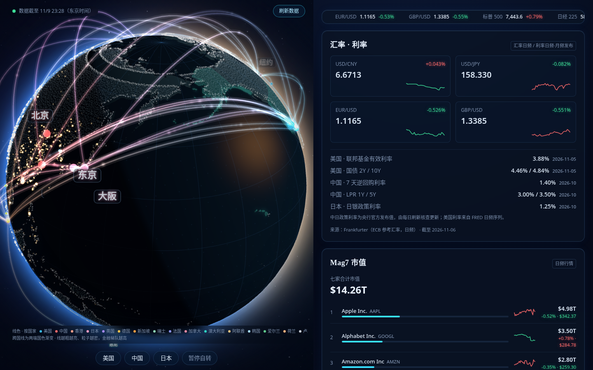
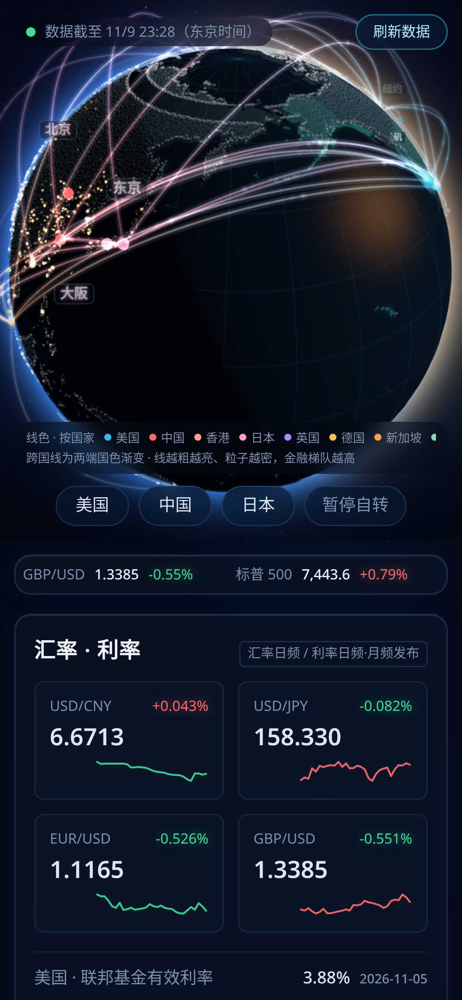

# Finance Globe — a 3D macro-finance globe

## 中文说明

3D 地球宏观金融监控仪的实现方法开源版：会转的地球上，利率、汇率、股指和城市灯光一起看。

- 实现文档：[`docs/IMPLEMENTATION.md`](docs/IMPLEMENTATION.md)（暖色阳光光照模型、国家分色弧线与彗星粒子、快慢分层数据刷新、来源标注规矩）
- 参考代码：[`reference/`](reference/)（国家配色表单一事实源、弧线粒子动画、数据分层；`npm install && npm run typecheck` 可直接验）
- 本仓只有方法与脱敏说明；真实数据快照不在本仓（存放在私有存档仓）

## 效果图 / Screenshots

运行中界面的实拍（2026-11-09；画面里的数字是截图那一刻的快照）：

A night-side 3D earth that turns macro data into geography: population-
weighted city lights, the world's financial centres as nodes, and
flowing arcs between them whose **colours encode the country** and whose
weight encodes the financial tier. Panels around the globe track FX,
policy rates (CN/US/JP), Magnificent-7 market caps, broad-money growth,
city rents and volatility.

This repository open-sources the **implementation method** — lighting
model, arc/particle design, tiered data refreshing and the mobile
payload diet. The owner's curated values and snapshots live in a
private archive.

## Design decisions worth stealing

- **Day/night is a sun-direction problem.** With the sun pointing too
  much toward the viewer, ~77% of the disc is lit. A near-side sun
  (single warm key light, ambient and fill dialled down, night side
  pushed to near blue-black) restores a half/half terminator and makes
  city lights pop on the dark side. No painted terminator band — the
  transition is nearly a hard edge.
- **Colour answers "whose line is this?"** Arcs are coloured by the
  country of their endpoints; cross-country arcs gradient along their
  length, particles and comet tails shifting colour as they travel,
  arrival ripples in the destination country's colour. Financial tier
  no longer touches colour — it drives line weight, brightness, arc
  height and particle size/density/speed. One shared colour table
  feeds nodes, labels, map highlights and the legend, so nothing drifts.
- **Comet particles**: a bright head with a fading tail, ease-out
  departure and ease-in arrival, staggered per arc, with a small ripple
  on arrival.
- **A drag-lock bug pattern**: the globe's rotation pause was released
  only on node click, so it stuck after ordinary drags. Release on
  pointer-up, gesture cancel, toggles and selection changes.

See [`docs/IMPLEMENTATION.md`](docs/IMPLEMENTATION.md) for the data
tiers, sources and the mobile optimisation ledger.

## Reference code

The [`reference/`](reference/) folder contains a reference
implementation of the core mechanisms, written from the documented
method (the production app runs on a hosted platform whose source is
not exportable).
