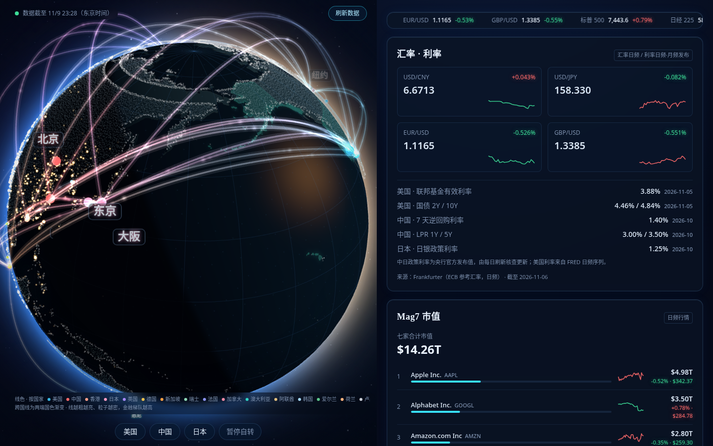
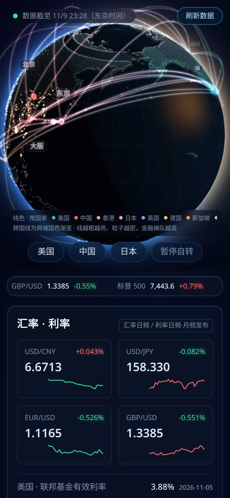

[English](README.md) | **简体中文**

# 金融星图 — 3D 宏观金融地球

3D 地球宏观金融监控仪的实现方法开源版：会转的地球上，利率、汇率、股指和城市灯光一起看。

- 实现文档：[`docs/IMPLEMENTATION.md`](docs/IMPLEMENTATION.md)（暖色阳光光照模型、国家分色弧线与彗星粒子、快慢分层数据刷新、来源标注规矩）
- 参考代码：[`reference/`](reference/)（国家配色表单一事实源、弧线粒子动画、数据分层；`npm install && npm run typecheck` 可直接验）
- 本仓只有方法与脱敏说明；真实数据快照不在本仓（存放在私有存档仓）

## 效果图

运行中界面的实拍（2026-11-09；画面里的数字是截图那一刻的快照）：

一颗夜面朝向的 3D 地球，把宏观数据变成地理：按人口加权的城市灯光、作为节点的全球金融中心、以及在它们之间流动的弧线——**颜色编码国家**，粗细编码金融层级。地球周围的面板跟踪汇率、中美日政策利率、美股七巨头市值、广义货币增速、城市租金与波动率。

本仓开源的是**实现方法**——光照模型、弧线/粒子设计、分层数据刷新与移动端载荷瘦身。所有者的策展值与数据快照存放在私有存档仓。

## 值得偷的设计决策

- **昼夜是个太阳朝向问题。** 太阳太朝向观看者时，盘面约 77% 被点亮。改用近侧太阳（单一暖色主光、压低环境光与补光、夜侧推到近乎蓝黑），晨昏线回到一半对一半，城市灯光在暗面跳出来。不画晨昏过渡带——交界几乎是硬边。
- **颜色回答「这是谁的线」。** 弧线按端点国家上色；跨境弧线沿长度渐变，粒子与彗尾在飞行中变色，到达涟漪是目的国颜色。金融层级不再碰颜色——它驱动线宽、亮度、弧高与粒子的大小/密度/速度。一张共享配色表同时喂节点、标签、地图高亮与图例，任何一处都不会漂。
- **彗星粒子**：亮头拖着渐隐的尾巴，出发缓出、到达缓入，每条弧错峰，到达时泛一个小涟漪。
- **拖拽锁死 bug 的典型形态**：地球的旋转暂停原本只在点击节点时才解除，普通拖拽后会卡住。要在指针抬起、手势取消、开关切换与选中变化时都解除。

数据分层、来源与移动端优化账本见 [`docs/IMPLEMENTATION.md`](docs/IMPLEMENTATION.md)。

## 参考代码

[`reference/`](reference/) 里是按文档方法复写的核心机制参考实现（生产应用运行在源码不可导出的托管平台上）。
